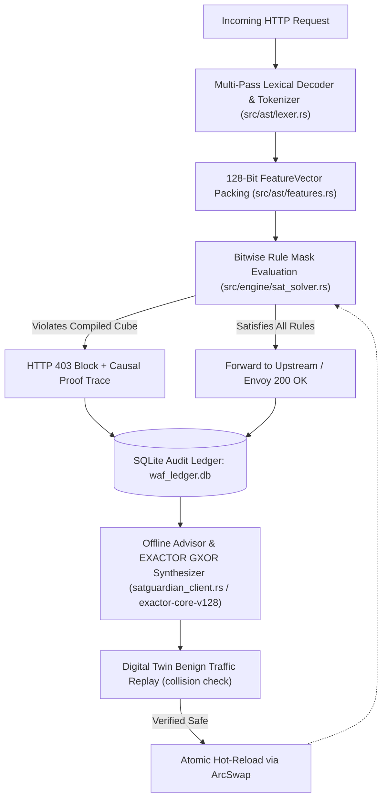

# SATGuardian Edge WAF — System Architecture & Implementation Reference

**Repository:** `satguardian`  
**Version:** `v0.3.0`  
**Scope:** Implementation architecture (Rust hot path & Python control plane)

> **Status: research prototype, not a production-ready WAF.** Metrics in this
> document are in-sample measurements on a hand-written corpus. The Python
> comparison harness runs local stand-ins, not real vendor products. See
> [STATUS.md](STATUS.md) and [corpus/README.md](corpus/README.md).

---

## 1. Architectural Overview

`satguardian` is a hybrid Web Application Firewall (WAF) divided into two strictly decoupled execution planes:

1. **In-Path Edge Data Plane (Native Rust — `src/`):** Evaluates HTTP requests in memory (tens of microseconds per payload; no network hop included) using multi-pass lexical normalization, a 128-bit feature bitmask (`FeatureVector(pub u128)`), and bitwise rule comparisons (`(minterm & required_mask) == expected_bits`).
2. **Out-of-Band Control & GXOR Synthesis Plane (Rust & Python — `src/cloud/satguardian_client.rs`, `exactor-core-v128`, `satguardian-advisor.py`):** Asynchronously reads the SQLite forensic audit ledger (`waf_ledger.db`), simplifies up to **128 Boolean variables (`u128` minterms)** using the **EXACTOR GXOR** engine over the complete **`{AND, OR, NOT, XOR}`** operator basis via Differential Gray Code Mapping, validates candidate rules against historical benign traffic in a **Digital Twin**, and hot-reloads validated rules into the Edge WAF via `ArcSwap`.

---

## 2. Verified Module Map

### 2.1 Rust Native Edge Engine (`src/`)

| File Path | Key Structs / Functions | Verified Implementation Details |
| :--- | :--- | :--- |
| `src/ast/lexer.rs` | `AstLexer`, `FeatureBinarizer` | Performs bounded multi-pass URL/HTML decoding, strips inline SQL/C comments (`/*...*/`), and extracts structural tokens across 5 attack domains (`SQLi`, `XSS`, `RCE`, `LFI`, `SSRF`). |
| `src/ast/features.rs` | `FeatureVector(pub u128)` | Maps HTTP methods, path attributes, Shannon character entropy thresholds, and lexical token presence into 128 discrete bit positions (`0..127`). |
| `src/engine/sat_solver.rs` | `SatguardianSatEngine`, `DynamicCompiledClause`, `evaluate_payload()` | Evaluates rules via bitwise masking `(minterm & required_mask) == expected_bits`, enforces per-IP token-bucket rate limits (`DashMap`), and formats human-readable causal proof traces. |
| `src/cloud/satguardian_client.rs` | `SatguardianCloudClient`, `SimplifyRequest`, `compile_equation_to_clauses()` | Invokes the **EXACTOR GXOR** Cloud Optimization API (`POST /api/simplify` backed by `exactor-core-v128`) to simplify up to 128 variables (`u128` minterms) over `{AND, OR, NOT, XOR}`, and compiles the reduced formula into runtime bitmask clauses. |
| `src/proxy/http_proxy.rs` | `start_reverse_proxy()` | Asynchronous Tokio/Hyper reverse proxy with `ArcSwap` lock-free rule hot-reloading and background SQLite audit logging. |
| `src/proxy/envoy_grpc.rs` | `EnvoyExtAuthzServer` | High-speed Envoy `ext_authz` authorization daemon supporting Unix Domain Sockets (`unix:///run/satguardian/waf.sock`). |

### 2.2 Python Benchmark, Advisor & Cloud Control Plane

| File Path | Key Classes / Functions | Verified Implementation Details |
| :--- | :--- | :--- |
| `satguardian_waf/core/solver_sat.py` | `SatguardianWAFSATEngine` | Python reference port of the lexical normalizer and rule evaluator. It is not the production engine and its latency says nothing about the Rust binary. |
| `satguardian_waf/agents/` | `SatguardianWAFAgent`, `CorazaWAFAgent`, `SafeLineWAFAgent`, `RegexBaselineAgent`, `PureJEVAgent` | Python benchmark agents. Four of them are explicitly labelled stand-ins for third-party techniques; none executes a vendor engine. |
| `satguardian-advisor.py` | `PatternAnalysisAgent`, `SimulationAgent`, `SynthesisAgent`, `ReportGenerator` | Reads `waf_ledger.db`, synthesizes candidate rules, replays them against recorded benign logs to find collisions, and generates `audit_report.html` and `audit_report.md`. Collision counts are recorded per run; no fixed FPR floor is claimed. |
| `satguardian-cloud-server.py` | `SATGuardianCloudHandler` | Reference cloud optimization API implementing Security Units (SU) metering, plan tier enforcement (128-variable SaaS cap), and `HTTP 402 SU_QUOTA_EXHAUSTED` fail-safe behavior. |

---

## 3. Measurements and Their Limits

No value is capped or floored. The engine reports whatever the corpus produces,
including failures.

### 3.1 Detection quality

| Corpus | First run (before fixes) | Current regression run | Status |
| :--- | :---: | :---: | :--- |
| `corpus/independent_v1.json` (63 attacks, 16 benign) | 51/63 recall (80.95%), 3/16 benign blocked (18.75% FPR) | 63/63, 0/16 blocked | In-sample regression |
| `corpus/heldout_v1.json` (17 attacks, 4 benign) | 11/17 recall (64.71%), 0/4 benign blocked | 17/17, 0/4 blocked | Consumed held-out batch |

Every corpus case was used to drive the fixes, so the current 100%/0% is a
regression floor, not a held-out quality estimate. The protocol and rules for
adding cases are in [corpus/README.md](corpus/README.md).

### 3.2 Latency

`cargo run --release -- benchmark -r 10000` measures in-memory rule evaluation
over the pinned corpus: roughly `20 µs` p50 and `22 µs` mean on a desktop CPU,
with p99 fluctuating around the `50 µs` target depending on machine load. It
excludes TLS, the proxy hop, the upstream service and stateful tracking.

The Python harness (`python run_benchmark.py 1000`) compares the Python reference
port against local Python stand-ins. It is not a vendor comparison and its
numbers must not be quoted as one.
