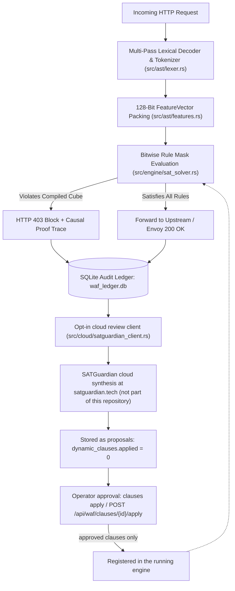

# SATGuardian Edge WAF — System Architecture & Implementation Reference

**Repository:** `satguardian`  
**Version:** `v0.3.0`  
**Scope:** Implementation architecture (Rust hot path & Python control plane)

> **Status: research prototype, not a production-ready WAF.** Metrics in this
> document are in-sample measurements on a hand-written corpus, plus one
> held-out run on the same author's payloads. The Python comparison harness runs
> local stand-ins, not real vendor products, and no third-party evaluation
> exists. See [STATUS.md](../status.md) and [corpus/README.md](../corpus.md).

---

## 1. Architectural Overview

`satguardian` is a hybrid Web Application Firewall (WAF) divided into two strictly decoupled execution planes:

1. **In-Path Edge Data Plane (Native Rust — `src/`):** Evaluates HTTP requests in memory (tens of microseconds per payload; no network hop included) using multi-pass lexical normalization, a 128-bit feature bitmask (`FeatureVector { bits: u128 }`, 40 named variables in the current catalogue), and bitwise rule comparisons (`(minterm & required_mask) == expected_bits`). This plane is self-contained: it enforces the rules already in the process and needs no network access to do so.
2. **Out-of-Band Control & Cloud Review Plane (Rust & Python — `src/cloud/satguardian_client.rs`, `src/ledger/sqlite_ledger.rs`, `satguardian-advisor.py`):** Reads the SQLite forensic audit ledger (`waf_ledger.db`) and, **only when the operator turns cloud review on** (`auto_sync_enabled`, `false` by default in `src/config.rs` and `waf_config.toml`), sends collected `u128` anomaly minterms to the **SATGuardian cloud synthesis** service at `satguardian.tech`. Boolean minimization runs on that service, not in this repository: the client receives a reduced equation, compiles it into bitmask clauses, and stores them as **proposals** (`dynamic_clauses.applied = 0`). Proposals do not enter the running engine and are not loaded at startup. A separate explicit action — `satguardian-waf clauses apply <id>` or `POST /api/waf/clauses/{id}/apply` — registers one clause in the engine.

---

## 2. Verified Module Map

### 2.1 Rust Native Edge Engine (`src/`)

| File Path | Key Structs / Functions | Verified Implementation Details |
| :--- | :--- | :--- |
| `src/ast/lexer.rs` | `AstLexer` | Performs bounded multi-pass URL/HTML decoding, strips inline SQL/C comments (`/*...*/`), and extracts structural tokens across 5 attack domains (`SQLi`, `XSS`, `RCE`, `LFI`, `SSRF`). |
| `src/ast/features.rs` | `FeatureVector(pub u128)`, `FeatureBinarizer` | Maps HTTP methods, path attributes, Shannon character entropy thresholds, and lexical token presence into 128 discrete bit positions (`0..127`). |
| `src/engine/sat_solver.rs` | `SatguardianSatEngine`, `DynamicCompiledClause`, `evaluate_payload()` | Evaluates rules via bitwise masking `(fv.bits & required_mask) == expected_bits`, consumes the per-IP sliding-window verdict computed by `src/stateful/limiter.rs` (`SAT-STATE-01`), and formats human-readable causal proof traces. |
| `src/cloud/satguardian_client.rs` | `SatguardianCloudClient`, `SimplifyRequest`, `compile_equation_to_clauses()` | Client-side HTTP caller for the **SATGuardian cloud synthesis** service (`POST https://satguardian.tech/api/simplify`). It bundles the variable catalogue and the pending `u128` minterms, receives a reduced equation over `{AND, OR, NOT, XOR}`, and compiles that equation into runtime bitmask clauses. The minimization itself runs on the service; no minimizer ships in this repository. |
| `src/ledger/sqlite_ledger.rs` | `SqliteLedger`, `propose_dynamic_clause()`, `load_applied_clauses()`, `load_pending_clauses()`, `approve_dynamic_clause()`, `reject_dynamic_clause()` | Persists cloud results with `applied = 0` (proposal) or `applied = 1` (approved). Startup loads approved clauses only; rejecting deletes a proposal and never removes a rule that is already enforcing. |
| `src/proxy/reverse_proxy.rs` | `ProxyState`, `proxy_handler()` | Asynchronous Tokio/Hyper reverse proxy sharing one `Arc<SatguardianSatEngine>` across requests, with background SQLite audit logging. A clause approved through the API is registered on that shared engine and applies to subsequent requests without restarting the process or dropping connections. |
| `src/envoy/ext_authz.rs` | `EnvoyAuthzState`, `create_envoy_authz_router()`, `serve_uds()` | Envoy `ext_authz` **HTTP** authorization daemon (`/ext_authz`), served over TCP or a Unix Domain Socket (`/var/run/satguardian/waf.sock`). |

### 2.2 Python Benchmark & Advisor Suite

| File Path | Key Classes / Functions | Verified Implementation Details |
| :--- | :--- | :--- |
| `satguardian_waf/core/solver_sat.py` | `SatguardianWAFSATEngine` | Python reference port of the lexical normalizer and rule evaluator. It is not the native Rust engine and its latency says nothing about the binary. |
| `satguardian_waf/agents/` | `SatguardianWAFAgent`, `CorazaWAFAgent`, `SafeLineWAFAgent`, `RegexBaselineAgent`, `PureJEVAgent` | Python benchmark agents. Four of them are explicitly labelled stand-ins for third-party techniques; none executes a vendor engine. |
| `satguardian-advisor.py` | `TrafficPatternAgent`, `SimulationAgent`, `RuleSynthesizerAgent`, `HumanApprovalAgent`, `ForensicReportAgent` | Reads `waf_ledger.db`, proposes candidate rules, replays them against recorded benign logs to find collisions, presents each proposal for the operator's approval (`--dry-run` lists without applying; there is no batch-approval option), and writes `audit_report.html` / `audit_report.md`. Collision counts are recorded per run; no fixed FPR floor is claimed. |

> **What is *not* in this repository:** the SATGuardian cloud service behind
> `POST https://satguardian.tech/api/simplify`. The Boolean minimizer, the
> variable-reduction heuristics and the Security Units (SU) accounting run
> server-side and are not distributed to customers. This codebase contains only
> the client that calls the service, the code that compiles the returned
> equation into bitmask clauses, and the code that evaluates those clauses.

---

## 3. Cloud Review and the Operator Approval Gate

The edge node is the default; the cloud is an opt-in review service. Free, you
get local protection on your own node. Paying, you get continuous review of new
patterns, update proposals and explanations — without ever giving up control of
your WAF.

1. **Nothing leaves the node unless you say so.** `auto_sync_enabled` defaults
   to `false` in `src/config.rs` and in `waf_config.toml`. With the default
   configuration the process never uploads observed anomalies.
2. **Three entry points, one behaviour.** The opt-in timer worker (every
   `autonomous_sync_interval_secs`, default 300 s), the CLI
   `satguardian-waf sync-simplify` and `POST /api/waf/sync-simplify` all send the
   pending minterms of `novel_anomalies` to the cloud and store what comes back
   as **proposals**: rows in `dynamic_clauses` with `applied = 0`.
3. **Proposals do not enforce.** A proposal is not registered in the running
   engine and is not loaded at startup — `main.rs` calls
   `ledger.load_applied_clauses()`, which selects `applied = 1` only. The sync
   response says so explicitly (`"status": "proposed"`, "Nothing was applied to
   the running rule set").
4. **Approval is a separate, explicit action**, always behind the existing admin
   token (`require_admin_token` in `src/api/server.rs`):

   | Decision | CLI | HTTP API |
   | :--- | :--- | :--- |
   | List open proposals | `satguardian-waf clauses list` | `GET /api/waf/clauses/pending` |
   | Approve one | `satguardian-waf clauses apply <id>` | `POST /api/waf/clauses/{id}/apply` |
   | Discard one | `satguardian-waf clauses reject <id>` | `DELETE /api/waf/clauses/{id}` |

   `clauses apply` marks the row approved, so the clause enforces from the next
   start; approving through the HTTP API on a running process additionally calls
   `engine.register_dynamic_clause()`, and the response reports
   `enforcing_now`. Registering on the shared in-memory rule set is what makes an
   **approved** clause take effect for subsequent requests without restarting the
   proxy or dropping connections.
5. **Rejecting cannot weaken you.** `reject_dynamic_clause` deletes a row where
   `applied = 0`. A rule already enforcing is never removed by it.
6. **`pending_anomalies` are patterns awaiting analysis.** They are logged
   minterms the engine did not recognize, not unprotected threats and not a
   coverage gap.

---

## 4. Measurements and Their Limits

No value is capped or floored. The engine reports whatever the corpus produces,
including failures.

### 4.1 Detection quality

| Corpus | First run (before fixes) | Current regression run | Nature of the number |
| :--- | :---: | :---: | :--- |
| `corpus/independent_v1.json` (63 attacks, 16 benign) | 51/63 recall (80.95%), 3/16 benign blocked (18.75% FPR) | 63/63, 0/16 blocked | In-sample regression floor |
| `corpus/heldout_v1.json` (17 attacks, 4 benign) | 11/17 recall (64.71%), 0/4 benign blocked | 17/17, 0/4 blocked | Batch consumed by the fix pass; in-sample regression floor |
| `corpus/heldout_v2.json` (98 attacks, 57 controls) | 55/98 detected (**56.1% recall**, 95% CI 46.3–65.5%), 4/57 controls blocked (**7.0% FPR**, 95% CI 2.8–16.7%) | — | The only held-out measurement, run once on 2026-11-04 |

Every case in the first two corpora was used to drive the fixes, so their
100%/0% rows are regression floors, not quality estimates. The held-out row is
the honest number to quote, and it is still a single run over payloads written
inside this project from public catalogues, with imagined benign controls:
**there is no third-party or independent evaluation.** The protocol and rules
for adding cases are in [corpus/README.md](../corpus.md);
`corpus/heldout_v2_report.json` lists every miss and every false positive.

### 4.2 Latency

`cargo run --release -- benchmark -r 10000` measures in-memory rule evaluation
over the pinned corpus: roughly `20 µs` p50 and `22 µs` mean on a desktop CPU,
with p99 fluctuating around the `50 µs` target depending on machine load. It
excludes TLS, the proxy hop, the upstream service and stateful tracking.

The Python harness (`python run_benchmark.py 1000`) compares the Python reference
port against local Python stand-ins. It is not a vendor comparison and its
numbers must not be quoted as one.
